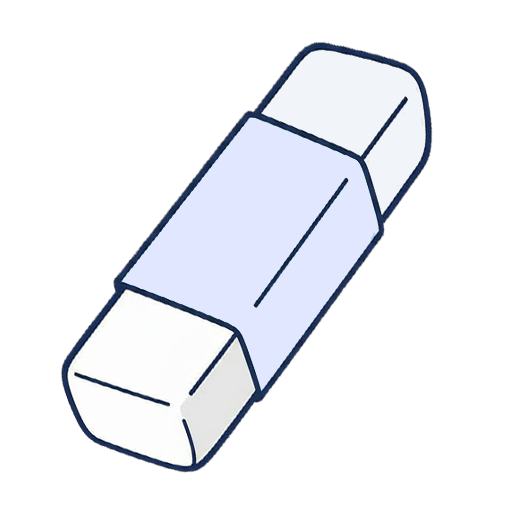

<p align="center">
  
</p>

<h2 align="center">BGX</h2>

<p align="center">一款免费、隐私优先的 AI 抠图工具，完全在浏览器中运行。</p>

<p align="center">
  <a href="https://bgx.itea.dev/">在线演示</a> ·
  <a href="#安装">安装</a> ·
  <a href="#桌面应用-electron">桌面应用</a> ·
  <a href="https://github.com/isixe/bgx">GitHub</a>
</p>

<p align="center">
  <a href="README.md">English</a>
</p>

## 功能特性

- **AI 智能抠图** - 采用先进的 ONNX 模型（U2Net、ISNet、BRIA RMBG、BEN2、MODNet、InSPyReNet），获得高质量结果
- **隐私保护** - 100% 客户端处理，图片绝不会离开你的设备
- **多种 AI 模型** - 6 大系列共 13 个专用模型，满足不同使用场景
- **多种导出格式** - PNG（透明背景）、JPG（白色背景）、WebP
- **拖拽 / 粘贴支持** - 通过拖拽、文件选择器或 Ctrl+V 粘贴上传图片
- **支持批量处理** - 高效处理多张图片
- **双语界面** - 支持英文与中文界面

## 技术栈

| 类别     | 技术                    |
| -------- | ----------------------- |
| 框架     | Astro 5.0 + React 18    |
| 语言     | TypeScript              |
| 样式     | Tailwind CSS            |
| 状态管理 | Zustand                 |
| AI/ML    | ONNX Runtime Web        |
| UI 组件  | Radix UI + Lucide Icons |

## 可用模型

6 大系列共 13 个模型，每个模型都针对速度、质量与适用主体做了不同的权衡。

### U2Net 系列

经典分割网络，速度快，适合日常使用。

| 模型            | 分辨率 | 大小   | 适用场景       |
| --------------- | ------ | ------ | -------------- |
| U2Netp          | 320px  | ~4MB   | 轻量、快速处理 |
| U2Net           | 320px  | ~168MB | 高精度通用     |
| U2Net Human Seg | 320px  | ~168MB | 人像照片       |
| Silueta         | 320px  | ~42MB  | 轻量剪影       |

### ISNet 系列

高分辨率模型，细节更精细。

| 模型          | 分辨率 | 大小   | 适用场景     |
| ------------- | ------ | ------ | ------------ |
| ISNet General | 1024px | ~170MB | 高分辨率通用 |
| ISNet Anime   | 1024px | ~168MB | 动漫/插画    |

### BRIA RMBG 系列

专业级抠图，质量最佳。

| 模型                | 分辨率 | 大小   | 适用场景       |
| ------------------- | ------ | ------ | -------------- |
| BRIA RMBG           | 1024px | ~176MB | 专业质量       |
| BRIA RMBG FP16      | 1024px | ~88MB  | 质量与体积均衡 |
| BRIA RMBG Quantized | 1024px | ~44MB  | 体积最小       |

### BEN2 系列

最先进的分割效果，边缘平滑细腻。

| 模型      | 分辨率 | 大小   | 适用场景               |
| --------- | ------ | ------ | ---------------------- |
| BEN2 FP16 | 1024px | ~209MB | 细小毛发，下载体积更小 |
| BEN2 FP32 | 1024px | ~403MB | 细小毛发，边缘最干净   |

### MODNet 系列

实时人像抠图，最适合人物与自拍。

| 模型   | 分辨率 | 大小  | 适用场景                   |
| ------ | ------ | ----- | -------------------------- |
| MODNet | 512px  | ~25MB | 人像、半透明发丝、自然边缘 |

### InSPyReNet 系列

ACCV 2022 分割，擅长处理头发与半透明边缘。

| 模型                 | 分辨率 | 大小  | 适用场景           |
| -------------------- | ------ | ----- | ------------------ |
| InSPyReNet Res2Net50 | 384px  | ~58MB | 中等速度下保留细节 |

## 安装

### 克隆仓库

```bash
git clone https://github.com/isixe/bgx.git
cd bgx
```

### 安装依赖

```bash
pnpm install
```

### 启动开发服务器

```bash
pnpm dev
```

应用将在 `http://localhost:8971` 上运行。

## 生产构建

```bash
pnpm build
```

生产构建产物将输出到 `./dist/`。

## 项目结构

```
bgx/
├── public/                  # 静态资源
│   └── favicon.ico
├── src/
│   ├── components/          # React 组件
│   │   ├── features/        # 功能组件
│   │   │   ├── ExportPanel.tsx
│   │   │   ├── ImagePreview.tsx
│   │   │   ├── ImageUploader.tsx
│   │   │   ├── ModelSelector.tsx
│   │   │   └── ModelsPage.tsx
│   │   ├── layout/          # 布局组件
│   │   └── ui/              # UI 组件
│   ├── config/              # 模型配置
│   │   └── models.ts
│   ├── hooks/               # 自定义 React Hooks
│   │   ├── useLanguage.ts
│   │   └── useRemoveBackground.ts
│   ├── layouts/             # Astro 布局
│   │   └── Layout.astro
│   ├── lib/                 # 工具库
│   │   ├── i18n/            # 国际化
│   │   │   ├── en.ts
│   │   │   ├── zh.ts
│   │   │   └── index.ts
│   │   └── utils.ts
│   ├── pages/               # Astro 路由
│   │   └── index.astro
│   ├── providers/           # 应用 Provider
│   ├── stores/              # Zustand 状态管理
│   ├── styles/              # 全局样式
│   ├── types/               # TypeScript 类型声明
│   └── utils/               # 辅助函数
├── astro.config.mjs         # Astro 配置
├── tailwind.config.mjs      # Tailwind CSS 配置
├── tsconfig.json            # TypeScript 配置
└── package.json             # 依赖
```

## 支持的图片格式

- JPG/JPEG
- PNG
- WebP

**最大文件大小：** 30MB

## 命令

| 命令             | 说明                               |
| ---------------- | ---------------------------------- |
| `pnpm dev`       | 在 `localhost:8971` 启动开发服务器 |
| `pnpm build`     | 构建生产站点至 `./dist/`           |
| `pnpm preview`   | 预览生产构建                       |
| `pnpm astro ...` | 运行 Astro CLI 命令                |

## 桌面应用 (Electron)

BGX 同样提供跨平台桌面应用。Electron 外壳通过特权 `app://` 协议并附带 `COOP`/`COEP` 响应头来提供静态构建产物，因此 WebAssembly 多线程（`SharedArrayBuffer`）与全部抠图功能都能完全离线运行。

| 命令                | 说明                                       |
| ------------------- | ------------------------------------------ |
| `pnpm dev:electron` | 运行 Astro 开发服务器并打开 Electron 窗口  |
| `pnpm start`        | 基于已有的 `./dist/` 构建产物启动 Electron |
| `pnpm build:win`    | 构建站点并打包 Windows 安装程序            |

打包产物输出到 `./release/`（绝不输出到属于 Astro 的 `./dist/`）：

- `BGX-<version>-win-x64.exe` - NSIS 安装程序（可选择安装目录、创建桌面快捷方式）
- `BGX-<version>-portable.exe` - 便携版可执行文件（无需安装）
- `win-unpacked/` - 可直接运行的解包应用

其他平台可通过将 `--win` 替换为 `--mac` 或 `--linux` 来打包。

所有正式发布的预编译安装包都会发布到 [GitHub Releases](https://github.com/isixe/bgx/releases) 页面，从源码构建之前建议先到该页面查看。

## 许可证

本项目基于 [MIT](LICENSE) 许可证授权。
